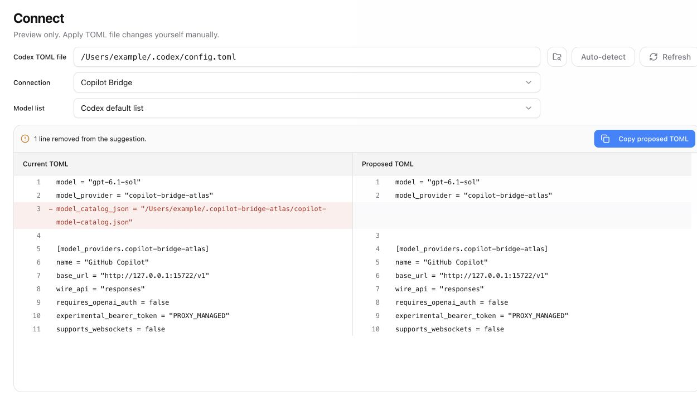
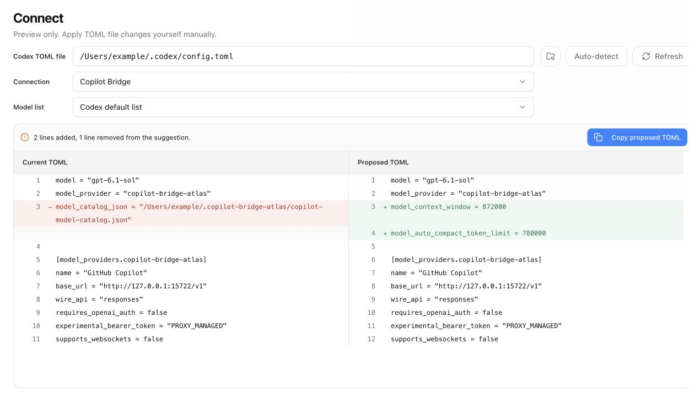

# Codex default list context suggestions

Both screenshots show the actual Connect React component and application styles
with **Codex default list** selected and the same synthetic TOML file.

The preview responses were generated by compiling the actual Rust suggestion
functions from the before and after revisions in an isolated fixture harness.
The before revision is `32e0ccf29965c00dd9dde8325c7756d506d26123` (6.0.9).
The example paths and configuration contain no account data.

## Before

Only the custom catalog reference is removed.

## After

The proposal also adds `model_context_window = 872000` and
`model_auto_compact_token_limit = 780000` in the existing side-by-side diff.

