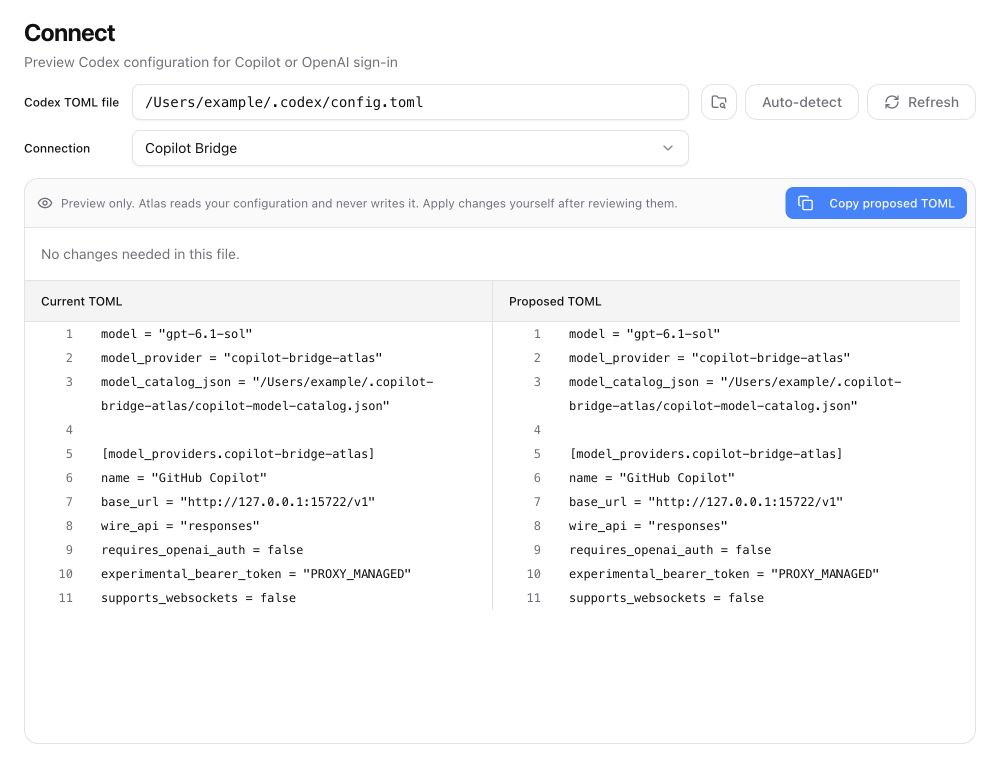
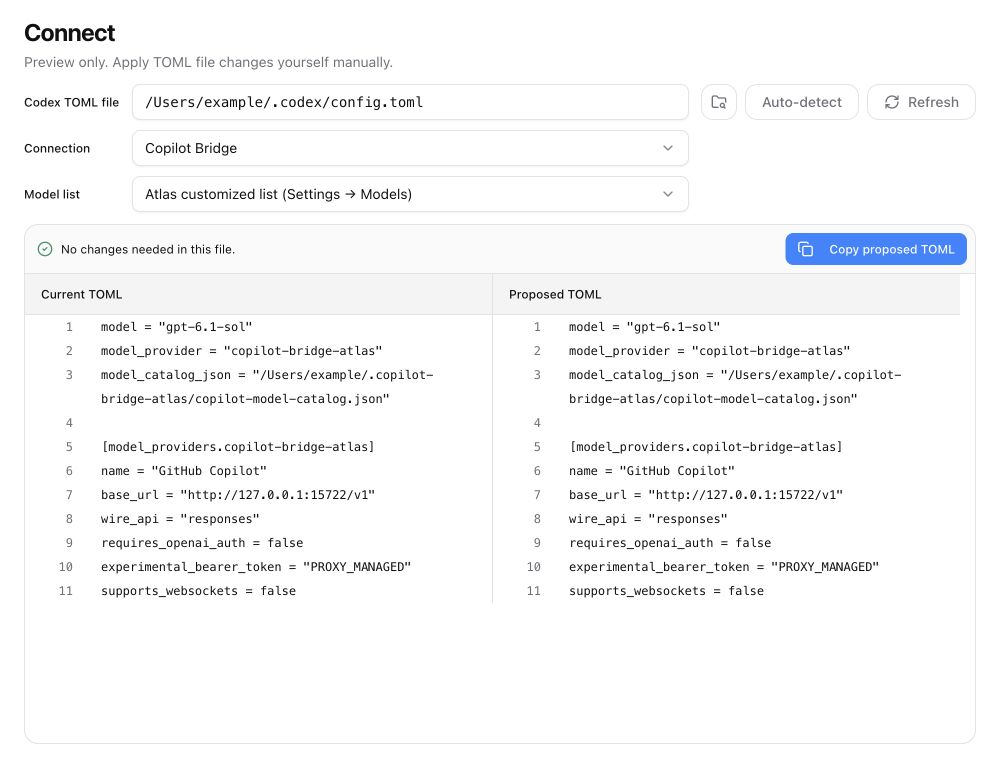
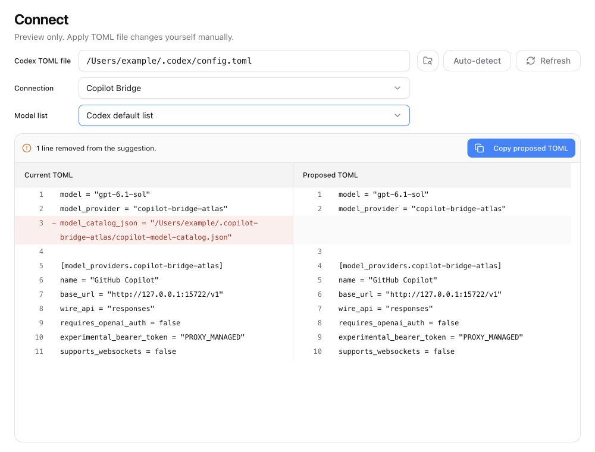

# Connect before and after

These screenshots use the actual React components and application styles,
rendered at 1000 × 760 with the same synthetic TOML fixture. The paths and
configuration are examples, not an account's private configuration.

The before component is from commit
`9e7e4a22f298d0041398dc2b0b6ecf114f1ae4db`.

## Before

## After: Atlas customized list

## After: Codex default list

